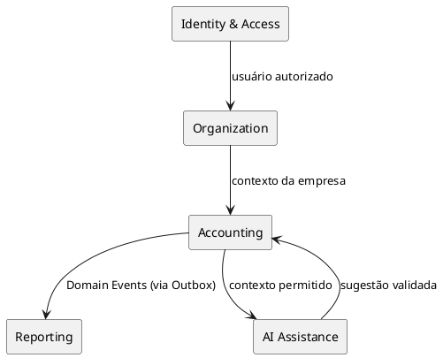
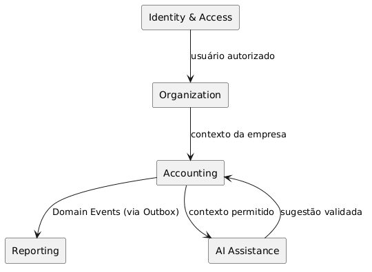
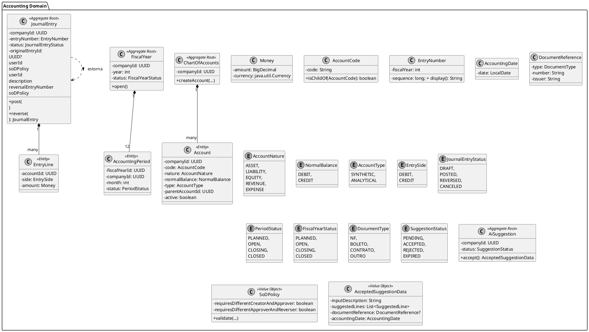
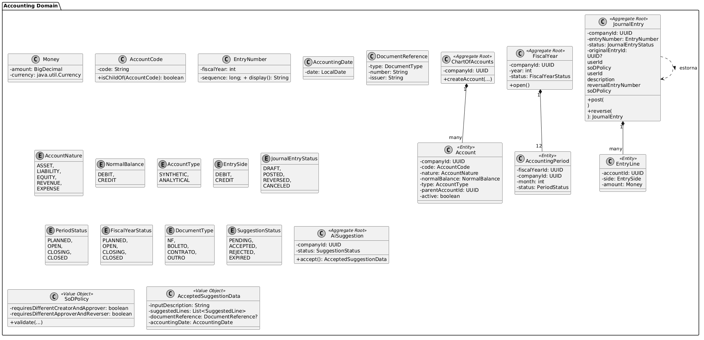
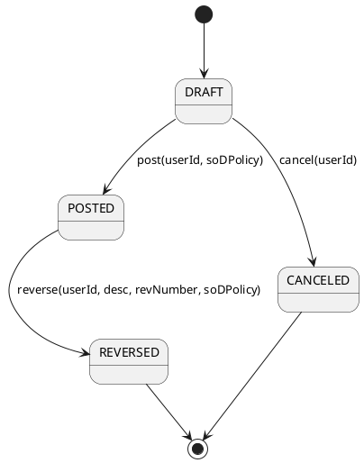
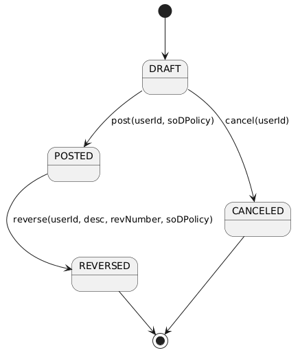
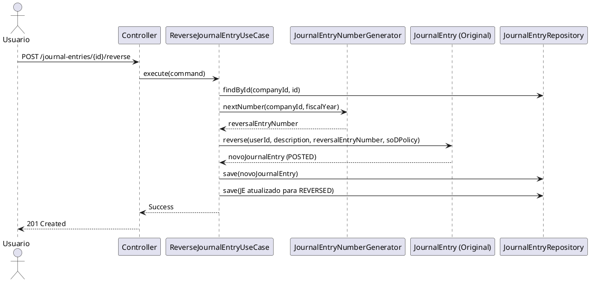
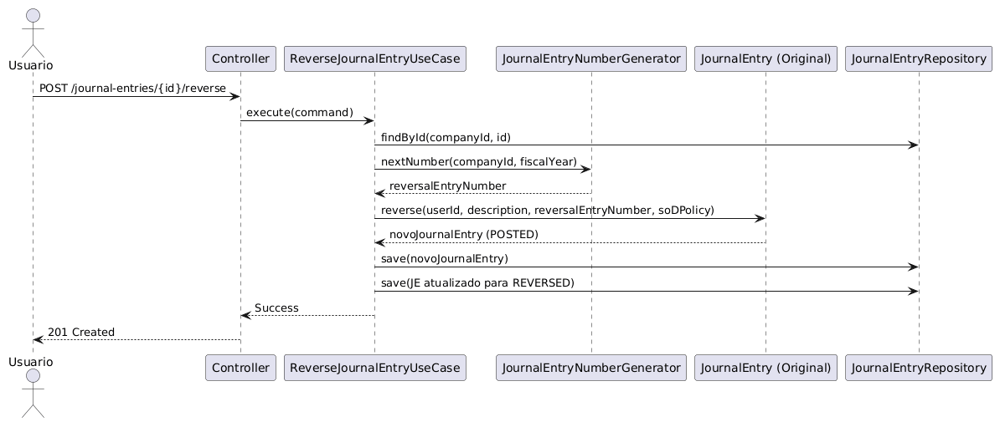

# Sistema Contábil

## Documentação Técnica e Arquitetural

**Versão:** 1.2.0
**Status:** Architecture Reference
**Idioma:** pt-BR
**Moeda inicial:** BRL
**Backend:** REST API
**Arquitetura:** DDD + Clean Architecture + Bounded Contexts + CQRS Leve
**Persistência:** PostgreSQL
**Java:** 21
**Framework:** Spring Boot

---

# PARTE I — FUNDAÇÃO

---

# 1. Visão do Produto

O **Sistema Contábil** é uma plataforma destinada ao registro, processamento, consulta e auditoria de informações contábeis utilizando como fundamento o princípio da **partida dobrada**.

Seu principal objetivo é fornecer um núcleo contábil confiável, consistente e auditável, capaz de representar: empresas, usuários, plano de contas, exercícios fiscais, períodos, lançamentos com numeração sequencial, partidas, saldos, relatórios, auditoria, segregação de duties e sugestões assistidas por IA.

O sistema trata o **motor contábil como fonte de verdade do domínio**. IA, integrações e UI não alteram diretamente o estado contábil.

### Decisão Arquitetural

O sistema não é um "CRUD de lançamentos". É um **motor de regras contábeis exposto por API**. A pergunta central não é "qual objeto salvar?", mas "esta operação é válida segundo as invariantes do domínio?".

---

# 2. Problema de Negócio

Operações contábeis precisam ser consistentes, rastreáveis, auditáveis, reversíveis (via estorno), associadas a empresa/período e protegidas contra alterações indevidas e fraudes (via SoD). Alterações diretas em lançamentos efetivados comprometem saldos, demonstrações e a confiança histórica.

Abordagem: **imutabilidade + eventos + estorno + auditoria + SoD**.

---

# 3. Missão

Construir um núcleo contábil confiável, consistente e auditável, capaz de registrar operações de partidas dobradas e produzir informações confiáveis, respeitando as normas contábeis brasileiras e princípios de segregação de funções.

---

# 4. Objetivos do Sistema

**Principal:** Núcleo de partidas dobradas com equilíbrio débito/crédito e numeração sequencial por empresa e exercício fiscal.
**Secundários:** Cadastro de empresas/usuários, controle de permissões com SoD configurável, plano de contas com hierarquia validada (MAX_DEPTH=7), abertura/fechamento de períodos e exercícios, criação/postagem/estorno de lançamentos com SoD, relatórios (diário, razão, balancete, DRE simplificada), auditoria, sugestões de IA e isolamento multi-tenant com defesa em profundidade.

---

# 5. Público-Alvo

Contador, auxiliar contábil, gestor financeiro, administrador, auditor e sistemas externos.

---

# 6. Escopo da V1

**Dentro:** Organização (empresas, usuários, permissões, SoD), Contabilidade (plano de contas, exercícios, períodos, lançamentos sequenciais, partidas, débito, crédito, postagem, estorno), Relatórios (diário, razão, balancete, DRE simplificada), Governança (auditoria, eventos, rastreabilidade, controle de acesso, SoD, multi-tenancy), IA (sugestão de classificação/contas/partidas, justificativa, confiança, aceite explícito).

**Fora:** Emissão de NF, cálculo tributário, folha, integração bancária, conciliação, estoque, contas a pagar/receber, SPED, ECD, ECF, assinatura digital, multi-moeda, contas de compensação, fechamento anual completo (apuração/transferência PL).

---

# 7. Princípios Arquiteturais

1. **Domain First:** Domínio não depende de Spring, JPA, PostgreSQL, HTTP, JWT ou fornecedor de IA.
2. **Dependency Inversion:** Regras de negócio não conhecem detalhes de infraestrutura.
3. **DDD:** Linguagem ubíqua, entidades, VOs, agregados, serviços de domínio, eventos, bounded contexts.
4. **Defense in Depth:** Segurança e isolamento em múltiplas camadas sobrepostas.
5. **Imutabilidade Contábil:** Uma vez efetivado, um fato contábil não é alterado — é estornado.

---

# PARTE II — DOMÍNIO

---

# 8. Bounded Contexts

- **Identity & Access:** Autenticação, usuários, papéis, permissões, tokens.
- **Organization:** Empresa, relacionamento usuário/empresa, contexto.
- **Accounting:** Motor contábil (plano de contas, exercícios, períodos, lançamentos, partidas, equilíbrio, postagem, estorno, SoD).
- **Reporting:** Consultas e relatórios (Read Model via CQRS).
- **AI Assistance:** Geração de sugestões contábeis (nunca altera estado diretamente).

---

# 9. Context Map




**Regra fundamental:** `AI → Accounting` significa `AI → Suggestion → Usuário → Application Use Case → Accounting Domain`.

---

# 10. Linguagem Ubíqua

| Termo | Significado |
| --- | --- |
| Exercício Fiscal | Período anual contábil (12 meses) |
| Período | Intervalo contábil mensal |
| Natureza | Classificação econômica (Ativo, Passivo, etc.) |
| Saldo Normal | Lado que aumenta o saldo da conta (D ou C) |
| Numeração Sequencial | Identificador de negócio (ex: 2026/000001) |
| Estorno | Operação que desfaz contabilmente um lançamento (técnicamente `reverse()`) |
| Segregação de Duties (SoD) | Regra que separa responsabilidades para prevenir fraudes |

---

# 11. Regras de Negócio (Invariantes)

- **RN01:** Lançamento efetivado possui ≥ 2 partidas.
- **RN02:** Σ Débitos = Σ Créditos.
- **RN03:** Partida possui apenas um lado (DEBIT ou CREDIT).
- **RN04:** Valor da partida > 0.
- **RN05:** Apenas conta analítica ativa recebe lançamento.
- **RN06:** Conta deve pertencer à mesma empresa do lançamento.
- **RN07:** Conta inativa não recebe novas partidas.
- **RN08:** Lançamentos apenas em período OPEN.
- **RN09:** Rascunho (DRAFT) pode ser alterado.
- **RN10:** Lançamento POSTED é imutável.
- **RN-PER-01:** Um `AccountingPeriod` só pode transitar de `PLANNED` para `OPEN` se o mês anterior estiver `CLOSED` ou se for o primeiro mês do exercício.
- **RN-SOD-01/02/03:** Criador ≠ Aprovador; Aprovador ≠ Estornador; Criador ≠ Estornador (configurável por tenant — ver ADR-019).
- **RN-SOD-04:** Violação de SoD com override gera AuditEvent de alto risco.
- **RN-EST-01:** Um lançamento que já é um estorno (`originalEntryId` preenchido) **não pode** ser estornado novamente. Correções exigem novo lançamento manual de ajuste.
- **RN-HIER-01:** Plano de contas sem ciclos, MAX_DEPTH=7 (default 5), analítica não pode ser pai, código da filha consistente com o pai (ver ADR-023).

---

# 12. Modelo de Domínio

## 12.1 Diagrama de Classes





## 12.2 Destaques dos Agregados

- **Account:** Possui `nature` (econômica) e `normalBalance` (D/C) como atributos independentes (ADR-015). Natureza não bloqueia partidas.
- **FiscalYear:** Agregado raiz independente. `open()` cria os 12 períodos no estado `PLANNED`. Eles devem ser abertos individualmente para `OPEN` via caso de uso, respeitando RN-PER-01 (mês anterior fechado ou primeiro do exercício).
- **JournalEntry:** Possui Technical Identity (`id: UUID`) e Business Identity (`entryNumber: EntryNumber`). O método `reverse(userId, description, reversalEntryNumber, soDPolicy)` recebe o número do estorno pronto do Use Case, mantendo o domínio puro (sem chamar gerador de sequência).
- **AiSuggestion:** `accept()` retorna o Value Object `AcceptedSuggestionData` (definição abaixo), nunca um Command da Application Layer.

## 12.3 Value Objects

- **Money:** `amount` (BigDecimal, scale 4, HALF_EVEN), `currency` (`java.util.Currency`, default BRL — ver ADR-022).
- **AccountingDate:** VO puro (`LocalDate`). **A extração de `fiscalYear` a partir de `AccountingDate` é feita pelo Use Case ou pelo `JournalEntryNumberGenerator` (Domain Service), nunca pelo VO.** A validação de pertencer a um período válido também é feita pelo Use Case ou `PeriodValidator`.
- **AcceptedSuggestionData:** VO de domínio contendo `inputDescription`, `suggestedLines` (lista de `SuggestedLine`), `documentReference?` e `accountingDate`. O Use Case usa esses dados para criar um `JournalEntry` em `DRAFT`.

---

# 13. Ciclo de Vida dos Agregados

## 13.1 JournalEntry





**Regra de Ouro do Estorno:** `reverse()` não altera o original. Muda seu status para `REVERSED` e retorna um **novo** `JournalEntry` já `POSTED` com partidas invertidas e `originalEntryId` apontando para o original. Ambos persistidos na mesma transação.

## 13.2 FiscalYear & AccountingPeriod

- `FiscalYear`: `PLANNED` → `OPEN` (cria 12 períodos `PLANNED`) → `CLOSING` (valida 12 períodos `CLOSED`) → `CLOSED`.
- `AccountingPeriod`: `PLANNED` → `OPEN` → `CLOSING` → `CLOSED`.
- **Concorrência:** Fechamento de período/exercício exige **lock pessimista** (`SELECT ... FOR UPDATE`) para evitar race conditions.

---

# 14. Domain Events

## 14.1 Anatomia

Todo evento carrega: `eventId`, `eventType`, `occurredAt`, `aggregateId`, `aggregateType`, `aggregateVersion`, `companyId`, `correlationId`, `causationId`, `userId`, `payload`.

- **correlationId:** Nasce no HTTP middleware, flui imutável por toda a cadeia.
- **causationId:** Aponta para o comando/evento causador imediato.
- **aggregateVersion:** Permite ordering e detecção de gaps nos consumidores.

## 14.2 Otimização de Payload

Para evitar eventos massivos no Outbox, `JournalEntryPosted` carrega metadados e totais. Para lançamentos com muitas linhas (>50), o payload contém apenas `entryId` e `entryNumber`. O Projection Handler busca os detalhes das linhas via Repository se necessário.

## 14.3 Idempotência e Limpeza

Consumidores usam tabela `processed_events` (PK: `event_id`).
**Política de retenção:** Job agendado via `@Scheduled` (ex.: diário às 03:00) realiza purge ou arquivamento de registros com mais de 90 dias, movendo-os para tabela `processed_events_archive` ou deletando-os.

---

# PARTE III — GOVERNANÇA

---

# 15. Segregation of Duties (SoD) — ver ADR-019

A SoD é uma invariante de domínio. O Use Case busca `SoDConfiguration` no banco, instancia o Value Object imutável `SoDPolicy` e o passa para o agregado:

```java
SoDPolicy policy = new SoDPolicy(config.requiresDiffCreatorAndApprover(), config.requiresDiffApproverAndReverser());
entry.post(userId, policy); // Lança SoDViolationException se falhar
```

**Override:** ADMIN pode forçar a operação com `overrideReason`, gerando um `AuditEvent` de ALTO RISCO.

---

# 16. Multi-tenancy Strategy (Defense in Depth) — ver ADR-012

Estratégia: Single Database, Single Schema com `company_id` em todas as entidades.

1. **Borda:** JWT contém `companyId`.
2. **Application Layer:** `CompanyContext` passado explicitamente.
3. **Repository Ports:** Métodos exigem `companyId` como parâmetro (ex: `findById(companyId, id)`).
4. **Infraestrutura:** Hibernate Filter global (`company_id = :companyId`).
5. **Banco de Dados:** Constraints `UNIQUE(company_id, ...)` e FKs compostas.

**ArchUnit Obrigatório:**

```java
classes().that().areAssignableTo(AggregateRoot.class)
    .should().haveFieldWithName("companyId");
// EntryLine é Entity filha, herdando o contexto do pai, portanto excluída da regra de raiz.
```

---

# 17. Imutabilidade e Estorno

Nunca `UPDATE` ou `DELETE` em `POSTED`. Sempre: `POSTED` → `REVERSED` + `NEW ENTRY (POSTED)`. Terminologia ubíqua: **Estorno** (código: `reverse()`).

---

# 18. Diagrama de Sequência: Estorno





---

# PARTE IV — ARQUITETURA

---

# 19. Persistência

PostgreSQL 16, JPA/Hibernate, Flyway.

- **Money:** `NUMERIC(19,4)` com banker's rounding (HALF_EVEN) — ver ADR-022.
- **Numeração Sequencial (ADR-014):** Tabela `journal_entry_sequences (company_id, fiscal_year, last_value)` com atualização atômica via `UPDATE ... RETURNING last_value + 1` ou `SELECT ... FOR UPDATE`. Evita gaps entre empresas e DDL dinâmico.

---

# 20. Concorrência

- **Optimistic Locking:** `version` em todos os Aggregate Roots.
- **Pessimistic Locking:** `SELECT ... FOR UPDATE` no fechamento de período/exercício.

---

# 21. Outbox Pattern — ver ADR-011

Polling agendado (ex: a cada 5s). Garante consistência transacional local. Consumidores devem ser idempotentes.

---

# 22. CQRS Leve para Reporting — ver ADR-013 e ADR-021

- **Write Model:** `journal_entries`, `journal_entry_lines`.
- **Read Model:** `account_balances` (projetado via eventos).
- **Limitação V1:** Relatórios operam estritamente por **período mensal**. Consultas por `DateRange` arbitrário (ex: 15/01 a 15/02) não são suportadas pelo Read Model e, se necessárias, cairão no Write Model com aviso de performance, ou serão movidas para a V2.

---

# 23. Idempotência

Header `Idempotency-Key`. Escopo da chave: `(companyId, userId, endpoint, idempotencyKey)`. TTL: 24 horas. Armazenamento: tabela `idempotency_keys` com índice único.

---

# 24. API REST e Versionamento

Base: `/api/v1/`. Versionamento por URI. Breaking changes exigem nova versão (`/api/v2/`). Endpoints depreciados recebem headers `Deprecation: true` e `Sunset: <data>`. Erros retornam `application/problem+json`.

---

# 25. Exceções de Domínio e Mapeamento HTTP

| Exceção de Domínio | HTTP Status | Descrição |
| --- | --- | --- |
| `UnbalancedEntryException` | 422 Unprocessable Entity | Σ débitos ≠ Σ créditos |
| `SoDViolationException` | 403 Forbidden | Violação de segregação de duties |
| `PeriodClosedException` | 409 Conflict | Lançamento em período fechado |
| `PeriodNotSequentialException` | 409 Conflict | Tentativa de abrir período sem fechar o anterior |
| `InactiveAccountException` | 422 Unprocessable Entity | Lançamento em conta inativa |
| `AccountNotFoundException` | 404 Not Found | Conta não existe |
| `InvalidHierarchyException` | 422 Unprocessable Entity | Violação de hierarquia do plano |
| `OptimisticLockException` | 409 Conflict | Conflito de concorrência |
| `ReversalOfReversalException` | 422 Unprocessable Entity | Tentativa de estornar um estorno |
| `JournalEntryNotFoundException` | 404 Not Found | Lançamento não existe |

---

# PARTE V — IMPLEMENTAÇÃO

---

# 26. Segurança

JWT Bearer. Papéis: `ADMIN`, `ACCOUNTANT`, `ACCOUNTING_ASSISTANT`, `MANAGER`, `AUDITOR`.

---

# 27. Inteligência Artificial

IA é camada de assistência. Fluxo: `IA → Suggestion (PENDING) → Usuário analisa → accept() → DRAFT → Validation → POSTED`.

- **Confiança (Confidence):** Escala 0.0 a 1.0. `>= 0.8`: Alta confiança. `0.5 - 0.79`: Média (requer revisão humana atenta). `< 0.5`: Baixa (não recomendada).
- **Circuit Breaker:** Se o LLM provider cair, o sistema retorna "Sugestão temporariamente indisponível" sem afetar o núcleo contábil.
- **Expiração:** Job agendado (`@Scheduled`) altera sugestões `PENDING` com mais de 7 dias para `EXPIRED`.

---

# 28. Estrutura de Pacotes e Clean Architecture

Padrão: `com.example.accounting.{bounded_context}.{layer}`. Domínio no centro, sem dependências externas.

```text
com.example.accounting
│
├── shared
│   ├── context/
│   │   └── CompanyContext.java          ← VO com companyId e userId extraídos do JWT
│   ├── exceptions/
│   │   ├── UnbalancedEntryException.java
│   │   ├── SoDViolationException.java
│   │   └── ...
│   └── valueobject/
│       └── Money.java
│
├── identity
│   ├── domain
│   ├── application
│   ├── adapter
│   └── infrastructure
│
├── organization
│   ├── domain
│   ├── application
│   ├── adapter
│   └── infrastructure
│
├── accounting
│   ├── domain
│   │   ├── model
│   │   │   ├── account/
│   │   │   ├── fiscalyear/
│   │   │   └── journal/
│   │   ├── valueobject
│   │   │   ├── AccountCode.java
│   │   │   ├── EntryNumber.java
│   │   │   ├── AccountingDate.java
│   │   │   ├── DocumentReference.java
│   │   │   └── AcceptedSuggestionData.java
│   │   ├── event
│   │   ├── service
│   │   │   ├── JournalEntryNumberGenerator.java
│   │   │   ├── ChartOfAccountsValidator.java
│   │   │   ├── PeriodValidator.java
│   │   │   └── BalanceCalculator.java
│   │   └── repository
│   │
│   ├── application
│   │   ├── usecase
│   │   ├── command
│   │   ├── query
│   │   └── projection
│   │
│   ├── adapter
│   │   ├── in
│   │   └── out
│   │
│   └── infrastructure
│
├── reporting
│
└── aiassistant
```

---

# 29. Estratégia de Testes

- **Unitários:** Domínio puro.
- **Integração:** Testcontainers (PostgreSQL, Flyway, transações).
- **API:** MockMvc / RestAssured.
- **Arquitetura:** ArchUnit (domain não depende de spring, Aggregate Roots têm `companyId`).
- **Property-Based Testing (JQWik):** `∀ lançamento válido → Σ débitos = Σ créditos`; `∀ estorno de L → saldo(L) + saldo(estorno(L)) = 0`.

---

# 30. Guia de Onboarding do Desenvolvedor

```bash
# 1. Subir infraestrutura local
docker-compose up -d

# 2. Aplicar migrations
./mvnw flyway:migrate

# 3. Rodar testes (incluindo property-based e archunit)
./mvnw clean test
```

---

# 31. Relatórios e Pendências Conhecidas

Diário, Razão, Balancete, DRE Simplificada.
> 🚧 **Pendência Conhecida (V1.2):** A composição exata da DRE (agrupamento de receitas/despesas por natureza) será definida em um ADR específico antes do início da Fase 6 (Reporting).

---

# PARTE VI — DECISÕES (ADRs)

---

# 32. ADRs Consolidados (V1.0 + V1.1 + V1.2)

## ADRs da V1.0 (mantidos)

- **ADR-001:** Clean Architecture — isolamento do domínio.
- **ADR-002:** DDD — domínio possui regras e invariantes relevantes.
- **ADR-003:** Double Entry no domínio — equilíbrio débito/crédito é invariante contábil.
- **ADR-004:** Imutabilidade de lançamentos POSTED — preservar histórico.
- **ADR-005:** Estorno (atualizado na V1.1 — era "Reversão") — rastreabilidade.
- **ADR-006:** IA não pode postar — segurança e governança.
- **ADR-007:** Outbox pattern — consistência entre transação e publicação.
- **ADR-008:** PostgreSQL — consistência transacional e maturidade.
- **ADR-009:** UUID como identidade técnica — identificação desacoplada de sequência interna.
- **ADR-010:** BigDecimal para valores monetários — precisão decimal.

## ADRs da V1.1 (novos)

- **ADR-011:** Outbox Publisher via Polling (V1).
- **ADR-012:** Multi-tenancy com `company_id` + Defense in Depth (5 camadas).
- **ADR-013:** CQRS Leve para Reporting via projeção de eventos.
- **ADR-014:** Numeração Sequencial via tabela `journal_entry_sequences` com lock atômico (evita gaps entre tenants).
- **ADR-015:** Separação `AccountNature` × `NormalBalance`.
- **ADR-016:** `FiscalYear` como Agregado Independente (períodos nascem `PLANNED`).
- **ADR-017:** "Estorno" como Termo Ubíquo (`reverse()` no código).
- **ADR-018:** Business Identity (`EntryNumber`) vs Technical Identity (`UUID`).
- **ADR-019:** SoD Configurável por Tenant com Override Auditado.
- **ADR-020:** Event Sourcing Fora da V1 (State-based persistence).
- **ADR-021:** Consistência Eventual Aceitável em Reporting (relatórios mensais na V1).
- **ADR-022:** `NUMERIC(19,4)` + Banker's Rounding.
- **ADR-023:** `MAX_DEPTH = 7` para Plano de Contas.

## ADRs da V1.2 (novos)

- **ADR-024:** `AccountingDate` como VO puro — extração de `fiscalYear` é responsabilidade do Use Case ou `JournalEntryNumberGenerator`, não do VO.
- **ADR-025:** `AcceptedSuggestionData` como Value Object de domínio — `accept()` não retorna Command da Application Layer.
- **ADR-026:** Regra de abertura sequencial de períodos (RN-PER-01) — mês só abre se anterior estiver fechado ou for o primeiro do exercício.
- **ADR-027:** Política de retenção de `processed_events` — 90 dias com purge via `@Scheduled`.
- **ADR-028:** `CompanyContext` como VO compartilhado no pacote `shared.context`.

---

# PARTE VII — CONSOLIDAÇÃO

---

# 33. Critérios de Aceite

- `D = C` obrigatório.
- `POSTED` imutável.
- Estorno possui vínculo com original.
- Estorno de estorno é proibido (RN-EST-01).
- Isolamento total por empresa (testado).
- SoD respeitada (ou override auditado).
- Numeração sequencial por empresa/exercício.
- Períodos abertos sequencialmente (RN-PER-01).

---

# 34. Roadmap

1. Bootstrap → 2. Identity → 3. Organization → 4. Accounting Core → 5. Audit & Events → 6. Reporting (CQRS) → 7. AI Assistance → 8. Frontend.

---

# 35. Ordem de Implementação

01. Linguagem Ubíqua → 02. Context Map → 03. Modelo de Domínio → 04. Value Objects → 05. Entidades → 06. Agregados → 07. Invariantes → 08. Estados e Transições → 09. Exercício Fiscal / Períodos → 10. Entry Number Generator → 11. Casos de Uso → 12. Domain Services → 13. Domain Events → 14. Multi-tenancy → 15. Persistência → 16. REST API → 17. Segurança + SoD → 18. Outbox → 19. CQRS / Read Models → 20. Reporting → 21. IA + Circuit Breaker → 22. Auditoria → 23. Testes (incluindo Property-Based) → 24. Docker → 25. CI/CD → 26. Frontend.

**Não começar pelo CRUD.** O primeiro código nasce do domínio.

---

# 36. Princípio Guia
>
> "O domínio contábil é a autoridade. Tudo o mais é detalhe de implementação."

---
